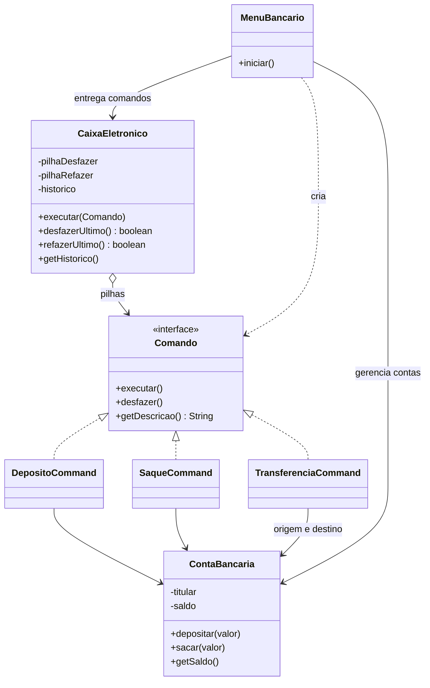

# Sistema Bancário – Padrão de Projeto Command

Projeto acadêmico em **Java 17** (Maven) que simula operações bancárias — depósito, saque e transferência — usando o padrão de projeto comportamental **Command**. O usuário interage por um **menu de console**, e cada operação é um objeto que pode ser executado, desfeito, refeito e registrado em um histórico.

## 1. Explicação do projeto

O sistema modela contas bancárias e operações sobre elas. Pelo menu, o usuário cria contas e escolhe operações. Em vez de chamar `conta.sacar(...)` diretamente, o cliente (`MenuBancario`) cria um **objeto de comando** que representa a operação e o entrega a um **invocador** (`CaixaEletronico`). Isso permite:

- **Criar contas** e consultar saldos pelo menu;
- **Executar** uma operação;
- **Desfazer** a última operação (ex.: estornar uma transferência);
- **Refazer** uma operação que foi desfeita;
- **Registrar um histórico** legível de tudo que aconteceu (`EXECUTADO`, `DESFEITO`, `REFEITO`);
- **Rejeitar operações inválidas** (saldo insuficiente, valor ≤ 0) sem sujar o histórico.

### Como o padrão aparece no código

| Papel no padrão | Classe | Responsabilidade |
|---|---|---|
| **Command** (interface) | `Comando` | Declara `executar()`, `desfazer()` e `getDescricao()` |
| **ConcreteCommand** | `DepositoCommand`, `SaqueCommand`, `TransferenciaCommand` | Encapsulam uma operação, seus parâmetros e a lógica para revertê-la |
| **Receiver** | `ContaBancaria` | Conhece as regras de negócio (`depositar`, `sacar`, validações) |
| **Invoker** | `CaixaEletronico` | Executa comandos, mantém as pilhas de desfazer/refazer e o histórico |
| **Client** | `MenuBancario` | Interface com o usuário: lê as opções, cria os comandos e os entrega ao invocador |
| — | `Main` | Ponto de entrada: apenas inicia o `MenuBancario` |

### Diagrama de classes



### Regras de funcionamento

- Um comando que lança exceção **não** entra no histórico nem nas pilhas.
- Executar uma nova operação **limpa** a pilha de refazer (mesmo comportamento de Ctrl+Z / Ctrl+Y).
- Chamar `desfazer()` em um comando que nunca foi executado não altera nenhum saldo.
- Na transferência, se o saque na origem funciona mas o depósito no destino falha, o valor volta para a origem (rollback), então nenhum dinheiro se perde.
- `desfazerUltimo()` e `refazerUltimo()` retornam `false` quando não há nada a desfazer/refazer.
- No menu, o valor aceita vírgula ou ponto (`49,90` ou `49.90`); texto, números negativos e valores vazios são rejeitados com mensagem.
- Nomes de titular não se repetem (sem diferenciar maiúsculas de minúsculas), e não é possível transferir para a própria conta.
- Se a entrada terminar (Ctrl+D / Ctrl+Z), o programa encerra normalmente.

## 2. Justificativa do padrão escolhido

### Por que o Command é adequado

Um sistema bancário é um domínio em que **operações são o centro do problema**, e não apenas dados. Quase tudo o que se pede dele (histórico, estorno, auditoria, refazer) trata a operação como um objeto que precisa ser guardado e manipulado. O Command atende isso diretamente:

1. **Desfazer e refazer.** Cada comando conhece seus parâmetros e sabe se reverter. Sem o padrão, o desfazer exigiria um `switch` gigante sobre o tipo da operação e variáveis soltas guardando valores antigos.
2. **Histórico e auditoria.** Como a operação é um objeto, ela pode ser guardada em uma lista e descrita (`getDescricao()`). Isso é a base para extrato, log de auditoria e rastreabilidade.
3. **Desacoplamento.** Quem dispara a operação (`CaixaEletronico`/`Main`) não conhece as regras de depósito, saque ou transferência; só conhece a interface `Comando`. Quem tem as regras (`ContaBancaria`) não sabe que existe histórico ou desfazer.
4. **Extensibilidade (Open/Closed).** Uma nova operação (pagamento de boleto, PIX, taxa) é uma nova classe que implementa `Comando`. Nenhuma classe existente precisa ser alterada, nem o `CaixaEletronico`.
5. **Operações compostas.** A `TransferenciaCommand` mostra que um comando pode agrupar vários passos (saque + depósito) tratados como uma única unidade para executar, desfazer e fazer rollback.
6. **Testabilidade.** Cada comando e o invocador podem ser testados isoladamente (ver `CaixaEletronicoTest`).

### Outros padrões que também poderiam ser usados

Nenhum deles substitui o Command por completo, mas cada um resolveria uma parte do problema:

| Padrão | Como poderia ser usado | Por que não é o principal aqui |
|---|---|---|
| **Memento** | Guardar um "snapshot" do saldo antes de cada operação e restaurá-lo para desfazer | Desfaz o *estado*, mas não representa a *operação* como objeto: não dá descrição, nem refazer natural, nem extensão por novas operações. Em transferências entre duas contas, o snapshot precisaria cobrir as duas. Pode ser combinado com o Command em sistemas em que reverter uma operação não é trivial |
| **Strategy** | Escolher dinamicamente o algoritmo de uma operação (ex.: taxa de saque por tipo de conta) | Resolve *como* calcular algo, não *quando/se* executar, nem permite desfazer ou registrar |
| **Template Method** | Definir o esqueleto comum de toda operação (validar → executar → registrar) | Reaproveita estrutura entre operações, mas não dá o objeto-operação que se guarda, desfaz e refaz |
| **Chain of Responsibility** | Passar a operação por validadores em cadeia (limite diário, antifraude, saldo) | Bom para validação, mas não cobre desfazer/histórico. Seria um complemento ao Command |
| **Observer** | Notificar auditoria, e-mail ou SMS quando uma operação ocorre | Resolve notificação, não a operação em si. Combina bem com o Command (o invocador notificaria os observadores) |
| **State** | Modelar o estado da conta (ativa, bloqueada, encerrada) e mudar o comportamento conforme ele | Trata de estados da conta, não de operações reversíveis |

**Conclusão:** o requisito central do projeto é tratar operações como objetos que podem ser executados, desfeitos, refeitos e registrados, e para isso o Command é o padrão mais direto. Padrões como Chain of Responsibility (validações) e Observer (notificações) seriam boas evoluções, combinadas com ele.

## 3. Estrutura do projeto

```
src/
├── main/java/com/banco/
│   ├── Comando.java               # interface Command
│   ├── DepositoCommand.java       # comando concreto
│   ├── SaqueCommand.java          # comando concreto
│   ├── TransferenciaCommand.java  # comando concreto (composto)
│   ├── ContaBancaria.java         # Receiver
│   ├── CaixaEletronico.java       # Invoker (desfazer, refazer, histórico)
│   ├── MenuBancario.java          # Client: menu interativo de console
│   └── Main.java                  # ponto de entrada
└── test/java/com/banco/
    ├── CaixaEletronicoTest.java   # testes do Invoker e dos comandos
    └── MenuBancarioTest.java      # testes do menu (entrada simulada)
```

## 4. Como executar

Requisitos: **JDK 17+** e **Maven 3.8+**.

```bash
# compilar
mvn compile

# abrir o menu interativo
java -cp target/classes com.banco.Main

# rodar os testes (21 testes)
mvn test
```

### Menu

```
1 - Criar conta
2 - Depositar
3 - Sacar
4 - Transferir
5 - Consultar saldos
6 - Desfazer última operação
7 - Refazer operação desfeita
8 - Ver histórico
0 - Sair
```

### Exemplo de sessão

Cria duas contas, deposita, saca, transfere, tenta um saque maior que o saldo, desfaz a última transferência, refaz a mesma transferência e consulta o histórico. O menu aparece a cada rodada, mas foi omitido nas repetições. O formato dos números segue o idioma do sistema (aqui, pt-BR).

```
=== SISTEMA BANCÁRIO (Padrão Command) ===

----------------- MENU -----------------
1 - Criar conta
2 - Depositar
3 - Sacar
4 - Transferir
5 - Consultar saldos
6 - Desfazer última operação
7 - Refazer operação desfeita
8 - Ver histórico
0 - Sair
Escolha uma opção: 1
Nome do titular: Mestre
Conta criada para Mestre com saldo R$0,00.

[... menu ...]
Escolha uma opção: 1
Nome do titular: Aluno
Conta criada para Aluno com saldo R$0,00.

[... menu ...]
Escolha uma opção: 2
Titular da conta: Mestre
Valor: 200
OK: Depósito de R$200,00 na conta de Mestre
Saldo de Mestre: R$200,00

[... menu ...]
Escolha uma opção: 3
Titular da conta: Mestre
Valor: 50
OK: Saque de R$50,00 na conta de Mestre
Saldo de Mestre: R$150,00

[... menu ...]
Escolha uma opção: 4
Titular da conta de origem: Mestre
Titular da conta de destino: Aluno
Valor: 80
OK: Transferência de R$80,00 (Mestre -> Aluno)
Saldo de Mestre: R$70,00
Saldo de Aluno: R$80,00

[... menu ...]
Escolha uma opção: 3
Titular da conta: Mestre
Valor: 500
Operação não realizada: Saldo insuficiente.

[... menu ...]
Escolha uma opção: 5
Mestre: R$70,00
Aluno: R$80,00

[... menu ...]
Escolha uma opção: 6
DESFEITO: Transferência de R$80,00 (Mestre -> Aluno)

[... menu ...]
Escolha uma opção: 7
REFEITO: Transferência de R$80,00 (Mestre -> Aluno)

[... menu ...]
Escolha uma opção: 8
--- Histórico ---
1. EXECUTADO: Depósito de R$200,00 na conta de Mestre
2. EXECUTADO: Saque de R$50,00 na conta de Mestre
3. EXECUTADO: Transferência de R$80,00 (Mestre -> Aluno)
4. DESFEITO: Transferência de R$80,00 (Mestre -> Aluno)
5. REFEITO: Transferência de R$80,00 (Mestre -> Aluno)

[... menu ...]
Escolha uma opção: 0
Encerrando. Até logo!
```

## 5. Limitações e possíveis evoluções

- Os valores usam `double` por simplicidade; um sistema real usaria `BigDecimal`.
- O histórico e as contas ficam em memória (não há persistência em banco de dados).
- Não há tratamento de concorrência (a classe não é thread-safe).
- As contas começam com saldo zero e só existem durante a execução do programa.
- Evoluções possíveis: novas operações (pagamento, PIX), validações em cadeia (Chain of Responsibility) e notificações (Observer).

## 6. Equipe

- João Felipe Macêdo da Silva
- Lucas André Seabra Azevedo Silva
